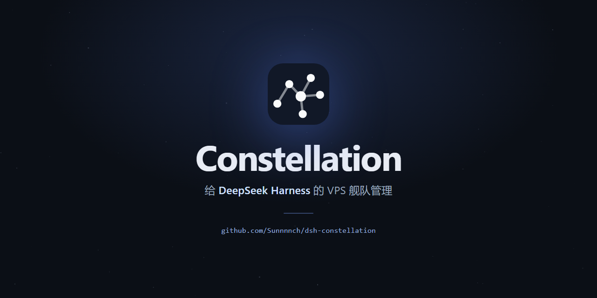
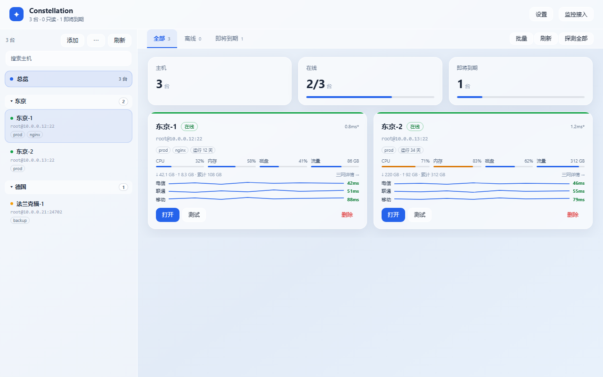
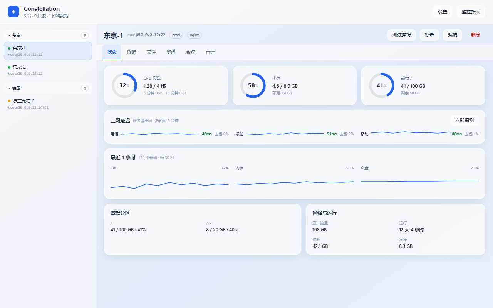

<p align="center">
  
</p>

<h1 align="center">Constellation</h1>

<p align="center">
  <code>@sunrise/dsh-vps</code> · 给 DeepSeek Harness 的服务器管理插件
</p>

<p align="center">
  <a href="LICENSE"></a>
  
  <a href="https://github.com/Sunnnnch/dsh-constellation/stargazers"></a>
</p>

SSH / VPS 管理插件：让 **DeepSeek Harness 的模型**和**人**共用同一份服务器资产。
模型能列主机、跑命令、传文件、开隧道、读状态；人可以从**左侧栏的「Constellation」入口**打开完整的 VPS 管理页，也可以在右侧栏用同一个面板边聊边看。

## 界面

**总览**：分组主机列表、状态卡片、每台机器的 CPU/内存/磁盘/流量与三网小图。



**主机状态**：环形指标、三网趋势与丢包、最近 1 小时曲线、磁盘分区与网络。



> 图按实际布局与配色还原（示例数据为 10.0.0.x 内网地址）。

## 入口

| 位置 | 形态 | 说明 |
|---|---|---|
| 左侧栏（导航栏） | 星图图标 + Constellation | **主入口**：注册到 `sidebar.panellist`，点开是 `main` 里的整页管理面板 |
| 右侧栏 | 「Constellation」标签页 | 次要入口：同一套主机列表 / 状态 / 终端 / 文件 / 隧道，紧凑版 |

整页面板：左侧主机列表（可搜索）、右侧详情（系统状态卡片、历史曲线、终端、SFTP 文件、隧道表单）。

## 安装

本包同时是 **能力包** 和 **bundle**（`dsh.bundle.patch`），可以直接从 GitHub 安装：

```bash
pnpm add github:Sunnnnch/dsh-constellation
```

固定到某个提交（可复现构建）：

```bash
pnpm add github:Sunnnnch/dsh-constellation#<commit-sha>
```

装进 DSH profile 时，把依赖和 bundle 一起声明：

```jsonc
// ~/.dsh/profiles/desktop/package.json
{
  "dependencies": {
    "@sunrise/dsh-vps": "github:Sunnnnch/dsh-constellation"
  },
  "dsh": { "profile": { "bundles": ["@deepseek-ai/dsh-base", "@deepseek-ai/dsh-web-app", "@sunrise/dsh-vps"] } }
}
```

然后在该 profile 目录 `pnpm install`，重启 DSH（或关掉再打开插件 entry）。本地开发用 `link:/path/to/dsh-constellation`。

> pnpm 10+ 默认拦截依赖的构建脚本，安装时会提示 `Ignored build scripts: ssh2, cpu-features`。ssh2 有纯 JS 回退，不跑也能用；想要原生加速就在安装目录执行 `pnpm approve-builds`。

## 模型侧工具

| 工具 | 用途 |
|---|---|
| `vps_list` | 列主机（先拿 id）；`verbose` 才做连接探测 |
| `vps_exec` | 一次性执行命令，返回 stdout/stderr/退出码 |
| `vps_batch` | 多机并行执行同一条命令（按 id 列表或 tag），逐台结果 |
| `vps_status` | 一次往返取系统/负载/内存/磁盘/网卡/失败单元/容器数 |
| `vps_history` | 最近 N 分钟的 CPU/内存/磁盘 min/avg/max + sparkline + 不可达次数 |
| `vps_monitors` | 外部 Komari / 哪吒面板的节点状态与在线率 |
| `vps_upload` / `vps_download` | SFTP 传输 |
| `vps_tunnel` | local / remote / dynamic(SOCKS5) 端口转发 |
| `vps_terminal_open` | 开持久 SSH 会话，返回 sessionId，配合 `terminal_send` / `terminal_read` / `terminal_close` |
| `vps_host_import` | 导入 `~/.ssh/config` |
| `vps_host_add` | 新增/修改主机（只存地址与认证方式，不存密码） |
| `vps_key_deploy` | 生成 ed25519 密钥、追加到远端 authorized_keys、切换清单 |

## 主机清单

`<DSH_HOME>/storages/vps/inventory.json`（默认 `~/.dsh/storages/vps/`）。首次运行且文件不存在时会自动导入 `~/.ssh/config`。

```jsonc
{
  "version": 1,
  "hosts": [
    {
      "id": "hk-1",
      "label": "香港-落地",
      "host": "1.2.3.4", "port": 22, "user": "root",
      "auth": { "kind": "key", "keyPath": "~/.ssh/id_ed25519", "passphraseRef": "DSH_VPS_HK1_PASSPHRASE" },
      "tags": ["prod"], "readonly": false,
      "expiresAt": "2027-03-01", "price": 199, "priceUnit": "year", "notes": "nginx + pg",
      "hostKey": { "fingerprint": "SHA256:...", "pinnedAt": "..." }
    }
  ]
}
```

- `readonly: true`：变更类命令（rm/mv/systemctl/docker/apt…）被拒绝。
- 首次连接采用 TOFU：记录主机指纹；之后指纹变化直接拒绝连接（防中间人 / 重装误认）。
- 认证方式三种：`key`（私钥）/ `password`（密码）/ `agent`（ssh-agent）。清单里只有**引用**：私钥只存路径，密码与口令只存凭据 key 名。
- 面板「添加主机」里选「密码」后直接填密码即可：值通过 RPC 写进 DSH 凭据库（`ctx.credentials.set`），`inventory.json` 里始终只有 `passwordRef`；编辑时显示「已保存」，留空表示不修改。
- 凭据 key 默认按主机 id 生成：`DSH_VPS_<ID>_PASSWORD` / `DSH_VPS_<ID>_PASSPHRASE`（`<ID>` 大写、非字母数字换成 `_`），也可以在清单里显式写 `passwordRef` / `passphraseRef`。
- 跳板机：`jump: ["bastion"]` 会先连跳板、再 `forwardOut` 到目标；目前只取链上的**第一台**，多级跳板待补（见已知限制）。
- 新机器接入：`vps_key_deploy` 生成 ed25519、写远端 `authorized_keys`、把清单切到新密钥；已有任一方式能登录即可。

## 配置（cordis.yml 行内）

| 字段 | 默认 | 含义 |
|---|---|---|
| `maxOutputBytes` | 65536 | 单次工具输出上限 |
| `defaultTimeoutMs` | 30000 | 命令默认超时 |
| `maxTimeoutMs` | 600000 | 工具可请求的最大超时 |
| `tunnelAllowPublic` | false | 是否允许隧道监听 `0.0.0.0` |
| `guardDangerous` | true | 危险命令（`rm -rf /`、`mkfs`、`dd of=/dev/`、`reboot`、`curl \| sh` 等）走审批；无审批通道时 fail-closed |
| `metricsIntervalMs` | 30000 | 采样间隔；`0` 关闭采样 |
| `alertThresholds` | `{memPct:90, diskPct:90, cpuPct:200}` | 告警阈值（`cpuPct` 是 load1/核数 的百分比） |
| `alertWebhook` | 无 | 新告警时 POST JSON 到这个地址 |
| `keepAliveMs` | 600000 | SSH 连接空闲多久后回收（10 分钟） |
| `monitors` | 无 | 外部监控源：`[{name, kind: komari\|nezha, baseUrl, tokenRef}]` |

## 安全闸门

`vps_exec` / `vps_batch` / `vps_shell send` 的命令会先过一遍 `lib/policy.js` 的规则表。命中危险模式时，插件通过 `tools/pre-execute` 返回 `ask`：**有审批通道就弹确认，没有就拒绝**（fail-closed），并把这次尝试写进审计日志（`action: guard-ask`）。

这是「绊线」不是沙箱——引号拼接、变量、编码都能绕过模式匹配，真正的硬边界仍然是 `readonly` 主机围栏和 DSH 的权限预设。

另外三条边界：

- 面板写入的凭据只允许 `DSH_VPS_*` 命名空间，不能借这个 RPC 覆盖别的插件凭据。
- `vps_upload` / `vps_download` 的本地路径必须在**工作区或用户目录**内，越界直接拒绝。
- 审计日志 `audit.jsonl` 超过 2 MiB 自动轮转一份 `.1`；面板「审计」页签按主机查看。

## 边栏面板

左侧栏「服务器」→ 整页：左侧主机列表（搜索、添加、编辑、导入、刷新），右侧详情带六个页签（状态 / 终端 / 文件 / 隧道 / 系统 / 审计）。
右侧栏「服务器」标签页 = 同一套组件紧凑排布，适合边聊边看。

主机详情头部还有四个动作：

- **测试连接**：TCP 握手 + 认证 + 一次 `echo`，返回耗时、认证方式和指纹。指纹不匹配时出现「信任新指纹并重试」（只在人点的时候清除 pin）。
- **批量**：勾选主机（或按 tag 一键选），并行跑一条命令，逐台显示退出码、耗时和输出。
- **外部**：查看配置的 Komari / 哪吒面板节点（见下文）。
- **编辑**：地址、认证方式、到期/价格/备注。

终端页签用 **xterm.js**（`lib/client.terminal.js` 懒加载 chunk，291 KiB）：vim / htop / tmux 可用，支持窗口缩放、Ctrl-C、复制粘贴。终端下面是**片段栏**：保存常用命令，一键插入；批量执行里也能插入片段。

文件页签支持逐项操作：**编辑**文本（弹窗保存）、**改名**、**权限**（八进制）、**删除**（目录只允许空目录）。写操作受 `readonly` 围栏与审计约束。

「系统」页签是四条固定只读探测（`systemctl` 服务、`docker ps`、`ss/netstat` 端口、`df -i` inode），不做自由命令；「隧道」页签会把打开的隧道写进 `tunnels.json`，重启后可一键「恢复上次」。

### 状态页（Komari 风）

- **三张头条卡**：延迟、丢包、在线时长。延迟/丢包是**本机到目标的 TCP 握手**测量（3 次，间隔 20s），不是 ICMP ping，也不是「三网」探测；卡片底部是分段条。
- **四张容量卡**：CPU 负载（load1/核数）、内存、根分区磁盘、累计流量（rx/tx），各带细进度条，≥70% 变黄、≥90% 变红。
- **最近 1 小时**：CPU / 内存 / 磁盘三条 sparkline + min/avg/max。
- **到期/价格/备注**：主机清单里的 `expiresAt` / `price` / `priceUnit` / `notes`，填了就显示；到期 ≤30 天在卡片和左侧列表上变黄，≤14 天变红。
- 状态每 5s、延迟每 20s、历史每 60s 刷新；离开页签即停。

## 指标历史与告警

- 后台每 30 秒给每台主机采一个点（一次 `vps_status` 探测），写成 `~/.dsh/storages/vps/metrics/<host>.jsonl`。
- **保留策略**：只留最近 **24 小时**，且每台最多 10000 行（防止采样间隔调小后文件疯长）；每次采样后按时间裁剪，磁盘占用有上限。
- 内存里每台主机只保留「最新一条采样」和三网缓存，不保留全量历史；终端回滚缓冲上限 4000 块 / 1 MiB。
- 告警是阈值 + 连续两次不可达（离线）；命中的告警显示在页面顶部横幅，并写入审计日志；配了 `alertWebhook` 还会 POST 出去。
- 模型侧用 `vps_history` 读同一份数据（带一行 sparkline），不需要自己解析原始日志。

## 外部监控（可选）

已经有 Komari / 哪吒的话，不必把历史再采一遍：在配置里加 `monitors`，面板「外部」按钮会拉取节点状态、CPU/内存、在线率、到期时间。凭据只放 `tokenRef`（值存 DSH 凭据），不写进配置。

```yaml
monitors:
  - name: komari
    kind: komari
    baseUrl: https://komari.example.com
    tokenRef: DSH_VPS_KOMARI_TOKEN
  - name: nezha
    kind: nezha
    baseUrl: https://nezha.example.com
    tokenRef: DSH_VPS_NEZHA_TOKEN
```

Komari 走公开的 `/api/nodes` + `/api/recent/:uuid`；哪吒走 `/api/v1/server` + `/api/v1/server/:id/online-history`（不需要 TSDB）。两者都是只读，拉取失败只影响这张卡片。

## 已知限制

- 终端走 SSE，不是 WebSocket（DSH 的 `/api/remote.mux` 归 api-gateway 独占，第三方插件没有公开的流式 RPC 入口）。
- 延迟/丢包的本机探针只测到 SSH 端口的 TCP 握手，代表「本机 ↔ 目标」这一段；本机走代理时会失真（面板会标「经本地代理」）。线路质量请看「三网」：那是**服务器自己** ping 三大运营商的测试 IP，不是本机到服务器。
- `ssh2` 的 `Client` 是裸类导出（`module.exports = Client`）。DSH Host 的 CJS 互操作会浅拷贝导出、把类变成 `{}`，所以本插件用 `lib/cjs.js` 直接求值 `ssh2/lib/client.js` 来拿构造函数；换任何「入口即类」的 CJS 依赖时都要照这个方式验证。
- 跳板机字段 `jump` 只支持链上第一台（多级跳板待补）。
- 只监听 `127.0.0.1` 的隧道默认策略无法关闭（有意为之）。

## 开发

```bash
pnpm install
node test/all.mjs            # 一次跑完三个套件（67 + 29 + 6 项）
node test/harness.mjs        # 67 项 Host 断言：握手/exec/SFTP/转发/TOFU/终端契约/延迟/RPC/密码/批量/片段/策略/指标/监控/跳板/密钥/文件操作/系统视图
node test/client-smoke.mjs   # 29 项 Client 断言：注册 + 组件深渲染
node test/terminal-chunk.mjs # 6 项：chunk 协议 + xterm UMD 求值 + 导出 TerminalBody
node scripts/build-terminal-chunk.mjs   # 改完 terminal-body.part.js 后重建 xterm chunk
```

终端 chunk 的发布链路也验证过：用 Host 的 `artifactRevision` 算法（sha1 of mtime/ctime/size）算出 bundle rev，再请求
`/plugins/@sunrise/dsh-vps/client.terminal.js?rev=<rev>`，返回 `200 text/javascript`，内容就是本包的文件。

改完 `lib/client.js` 后不必重启应用：用 `plugin_manager` 把 `include:vps` 关掉再打开，会重启 Loader entry 并重新发布 client bundle。
只改 `cordis.patch.yml` / `package.json` 也一样——manifest 只在 entry 启动时读取。

面板里的「设置」对话框把阈值、采样间隔、三网选项、Webhook、危险命令开关写进 `~/.dsh/storages/vps/settings.json`（覆盖 cordis 配置，改采样间隔会立即重启采样器）；主机清单的导入/导出在左栏 `⋯` 菜单里。

i18n：界面文案以中文为主，`locale` 词典只覆盖面板标题/入口等少量键；英文环境会看到混合语言——这是明确取舍，不是漏翻。
